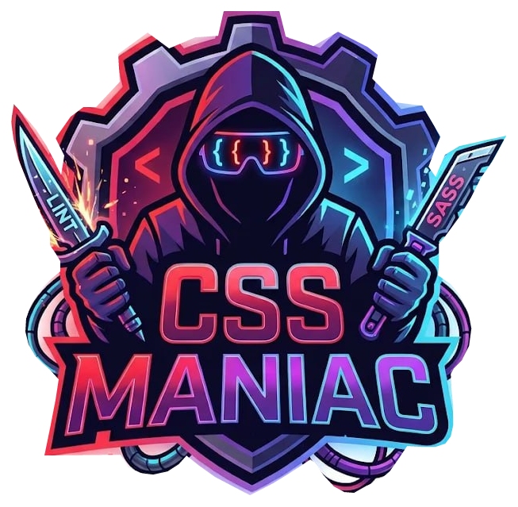

<h1 align="center"></h1>

[English](README.md) · Русский

Помогите агенту писать, исправлять и проверять CSS и SCSS с учётом правил проекта и без лишних изменений.

<p align="center">
  <a href="CHANGELOG.md#110--2026-11-23"></a>
  <a href="https://agentskills.io/"></a>
  <a href="LICENSE"></a>
</p>

<p align="center"><a href="ARCHITECTURE.md">ARCHITECTURE</a> · <a href="CHANGELOG.md">CHANGELOG</a> · AGENTS</p>

## Установка

Установите Node.js и запустите [skills CLI](https://github.com/vercel-labs/skills) в своём проекте:

```sh
npx skills add coca-in-a-cola/css-maniac --skill css-maniac
```

Выберите агента и область установки в запросах программы. Репозиторий должен быть публичным или доступным вашему Git-клиенту. Перед установкой прочитайте навык: его инструкции выполняются с правами агента.

**Claude Code:** можно установить плагин через каталог внутри сессии:

```text
/plugin marketplace add coca-in-a-cola/css-maniac
/plugin install css-maniac@css-maniac
```

Завершите установку в карточке плагина. Для локальной копии укажите её абсолютный путь вместо адреса GitHub. Подробнее — в [документации Claude Code](https://code.claude.com/docs/en/plugin-marketplaces).

**Вручную:** скопируйте всю папку [`skills/css-maniac/`](skills/css-maniac/) вместе с материалами и шаблонами в папку навыков: `$HOME/.agents/skills/css-maniac` для Codex или `$HERMES_HOME/skills/css-maniac` для активного профиля Hermes (`$HOME/.hermes/skills/css-maniac` для профиля по умолчанию). Сначала проверьте папку назначения; не перезаписывайте существующий навык без проверки. Документация: [Codex](https://developers.openai.com/codex/skills/), [Hermes](https://hermes-agent.nousresearch.com/docs/user-guide/features/skills/).

## Состав

- [`SKILL.md`](skills/css-maniac/SKILL.md) — правила проекта, диагностика, раскладка, цвет, доступность и порядок ревью.
- [`references/`](skills/css-maniac/references/) — CSS-паттерны, палитра и точки перелома для SCSS.
- [`templates/`](skills/css-maniac/templates/) — шаблон правил CSS и необязательная конфигурация Stylelint.

Правила проекта важнее настроек навыка по умолчанию. Навык просит агента запустить линтер проекта, проверить отображение и оценить контраст, но сам линтер не устанавливает и проверки не выполняет. Проверьте отображение на нужных ширинах, в состояниях и темах; контраст измерьте подходящим инструментом. Если проверку провести не удалось, результат остаётся неподтверждённым.

## Благодарности и лицензия

Источники вдохновения: [ub-mode](https://github.com/unclebob/ub-mode), принцип наименьшей мощности W3C TAG, flow-утилита Kevin Powell, Stack и owl-селектор из Every Layout, работа Lea Verou о контрасте OKLCH, тона и слои состояний Material 3.

[MIT](LICENSE)
