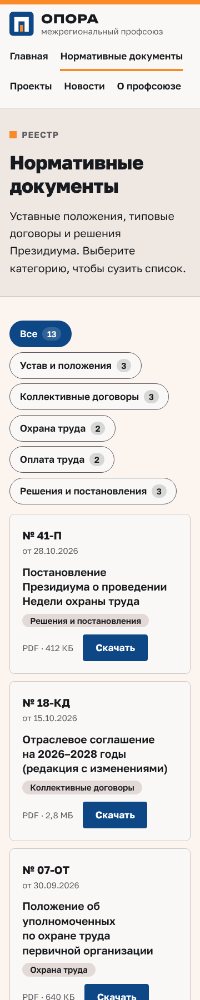
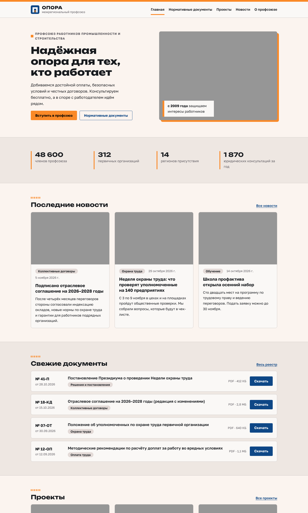
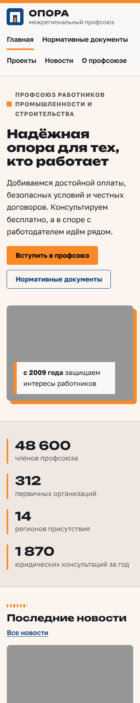
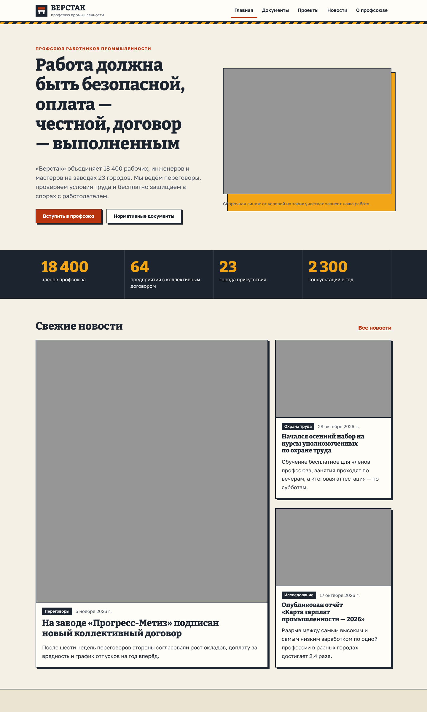
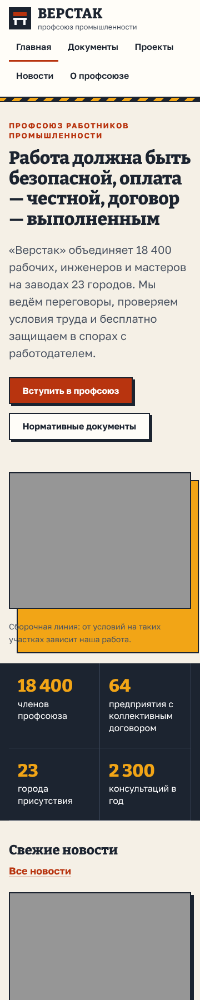

# run-2

Generated by `tools/compare.py`. Photos load as grey stand-ins of their real size; other external requests are blocked. Checks run on every page at 360, 768, 1280 px, light and dark.

| | with-skill | without-skill |
|---|---|---|
| authored CSS/SCSS lines | 852 | 266 |
| hex colors | 0 | 25 |
| px in declarations (not 0/1/999) | 0 | 44 |
| !important | 0 | 1 |
| @media | 16 | 4 |
| @container | 0 | 0 |
| vh units | 0 | 0 |
| position: absolute | 2 | 6 |
| max z-index | 1 | 10 |
| transition: all | 0 | 0 |
| skill-gate violations | 0 | 142 |
|   top rules | — | declaration-property-value-disallowed-list 72, csstools/use-logical 68, declaration-no-important 1, declaration-property-value-allowed-list 1 |
| shipped JS lines | 0 | 29 |
| pages | 11 | 12 |
| horizontal overflow (page@width) | none | documents/index@768, documents/index@768-dark |
| overflow if photos fail to load | none | documents/index@768 |
| contrast fails / texts checked | 0 / 3450 | 0 / 3378 |
| agent model | sonnet | sonnet |
| agent tokens | 147,261 | 120,217 |
| agent tool_calls | 47 | 44 |
| agent minutes | 7.5 | 4.6 |

